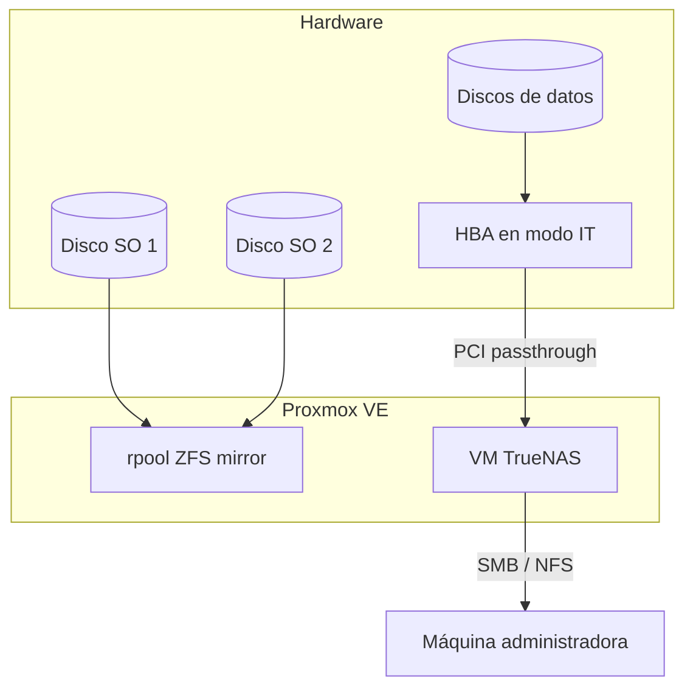

tags: [wiki, homelab, proxmox, zfs, truenas, almacenamiento, smb]
aliases: [Guía Proxmox ZFS, Guía TrueNAS VM, Homelab Storage]
nivel: intermedio
tiempo-estimado: 2-3 h
fecha: 2026-11-22
links: [[01a Recursos]], [[03 Hipervisor]], [[06 Monitoreo]]

# 04 Almacenamiento en Proxmox - ZFS RAID 1 y TrueNAS

> [!abstract] Qué vas a lograr
> 1. Un nodo Proxmox VE instalado sobre **ZFS en espejo (RAID 1)**.
> 2. Una **VM de TrueNAS** que administra tus discos de datos.
> 3. Una **carpeta compartida SMB** (`homelab-logs`) montada de forma segura en la máquina de administración.
>
> Esta nota unifica "04 Almacenamiento" (resumen) y "04 Guia almacenamiento" (guía completa). **Requisitos previos:** conocimientos básicos de Linux y red, acceso al BIOS/UEFI, 2 discos idénticos para el sistema y discos adicionales para datos. Los tamaños y tipos de disco están en [[01-01 Recursos#3.4 Almacenamiento]].

## Índice de esta nota

- [[#1. Visión general de la arquitectura]]
- [[#2. Proxmox VE sobre ZFS RAID 1 (espejo)]]
  - [[#2.1 Qué te da y qué no]]
  - [[#2.2 Recomendaciones de hardware]]
  - [[#2.3 Instalación]]
  - [[#2.4 Verificación post-instalación]]
  - [[#2.5 Limitar la memoria del ARC en el host]]
  - [[#2.6 Reemplazo de un disco fallado]]
- [[#3. TrueNAS como máquina virtual]]
  - [[#3.1 Qué edición elegir]]
  - [[#3.2 Recursos de la VM]]
  - [[#3.3 Passthrough de la controladora HBA]]
  - [[#3.4 Red]]
  - [[#3.5 Instalación y creación del pool]]
- [[#4. Carpeta compartida para logs y administración]]
- [[#5. Seguridad - checklist mínimo]]
- [[#6. Pruebas de funcionamiento]]
- [[#7. Problemas frecuentes]]
- [[#8. Mantenimiento y buenas prácticas]]
- [[#9. Glosario rápido]]
- [[#10. Referencias]]

---

## 1. Visión general de la arquitectura



| Capa | Función | Quién gestiona los discos |
|---|---|---|
| `rpool` (mirror) | SO de Proxmox, VMs y contenedores | Proxmox (ZFS) |
| Pool de datos | Archivos, backups, logs, media | TrueNAS (ZFS) |

> [!warning] Regla de oro
> **Cada pool ZFS debe ser gestionado por un solo sistema.** Con passthrough, el pool de datos pertenece a TrueNAS: **nunca lo importes en el host Proxmox** (riesgo de corrupción).

---

## 2. Proxmox VE sobre ZFS RAID 1 (espejo)

Con dos discos idénticos para el sistema, ZFS en espejo es la mejor práctica. (Instalación general de Proxmox en [[03 Hipervisor]].)

### 2.1 Qué te da y qué no

- **Integridad de datos:** checksums en todos los bloques; con espejo, si detecta un bloque corrupto lo **repara solo** con la copia sana (*self-healing*).
- **Redundancia:** si un disco falla el sistema sigue en modo `DEGRADED` hasta que lo reemplaces.
- **Snapshots casi instantáneos** por *copy-on-write*.

> [!danger] RAID no es backup
> El espejo protege contra **la falla de un disco**, no contra borrado accidental, ransomware, errores humanos, robo o incendio. Necesitás además **backups 3-2-1** (3 copias, 2 medios, 1 fuera del sitio). Ver [[#8. Mantenimiento y buenas prácticas]].

> [!note] Terminología
> Un espejo da **redundancia**, no "alta disponibilidad" en sentido estricto (varios nodos con failover). Con un solo servidor, si cae el equipo cae el servicio.

### 2.2 Recomendaciones de hardware

- Discos **idénticos o de capacidad similar** (se aprovecha la del menor).
- **No uses RAID por hardware** con ZFS: debe ver los discos directo (AHCI/JBOD/HBA).
- Evitá **HDD SMR** (rendimiento pobre en *resilvering*).
- En SSD, preferí **PLP** y buena resistencia (TBW): los SSD de consumo se desgastan rápido con ZFS + VMs.
- Conectá un **UPS** para evitar cortes bruscos.

### 2.3 Instalación

1. Descargá la ISO desde proxmox.com y creá un USB booteable.
2. En **Target Harddisk → Options** elegí **Filesystem: `zfs (RAID1)`**, seleccioná **ambos discos** (el resto en `-- do not use --`) y dejá `ashift` (12) y compresión por defecto.
3. Completá país, contraseña de `root`, correo y red (**IP estática** recomendada).

### 2.4 Verificación post-instalación

```bash
# Debe mostrar ONLINE y mirror-0 con ambos discos
zpool status rpool
zpool list
```

### 2.5 Limitar la memoria del ARC en el host

Por defecto ZFS puede usar hasta ~50 % de la RAM como caché (ARC). En un host con VMs conviene fijar un tope (ejemplo 4 GiB; la propuesta de [[01-01 Recursos#4. Reparto de recursos por servicio (64 GB)]] reserva hasta 8 GB):

```bash
echo "options zfs zfs_arc_max=$((4 * 1024 * 1024 * 1024))" > /etc/modprobe.d/zfs.conf
update-initramfs -u -k all
reboot
```

### 2.6 Reemplazo de un disco fallado

> [!warning] Importante
> El disco de arranque de Proxmox tiene además **partición de arranque (ESP)**. Recreala en el disco nuevo o el sistema podría no arrancar si falla el otro. Consultá siempre la documentación oficial para tu versión.

Resumen (usá `ls -l /dev/disk/by-id/` para identificar los discos):

```bash
# 1. Ver qué disco falló
zpool status rpool

# 2. Copiar tabla de particiones del disco SANO al NUEVO y randomizar GUIDs
sgdisk <DISCO_SANO> -R <DISCO_NUEVO>
sgdisk -G <DISCO_NUEVO>

# 3. Reemplazar en el pool (partición ZFS, normalmente la 3)
zpool replace -f rpool <PARTICION_ZFS_VIEJA> <PARTICION_ZFS_NUEVA>

# 4. Reconfigurar arranque (partición ESP, normalmente la 2)
proxmox-boot-tool format <PARTICION_ESP_NUEVA>
proxmox-boot-tool init <PARTICION_ESP_NUEVA>

# 5. Monitorear el resilver
zpool status rpool
```

---

## 3. TrueNAS como máquina virtual

Para gestionar volúmenes grandes, discos dedicados y carpetas compartidas avanzadas se despliega **TrueNAS** en una VM (KVM) dentro de Proxmox.

### 3.1 Qué edición elegir

- **TrueNAS SCALE** (Debian; las versiones recientes se publican como *Community Edition*): recomendada para instalaciones nuevas.
- **TrueNAS CORE** (FreeBSD): en mantenimiento, sin funciones nuevas. Evitarlo en proyectos nuevos.

> [!note] Los nombres de menús varían entre versiones. Esta guía usa los de SCALE / Community Edition.

### 3.2 Recursos de la VM

| Recurso | Mínimo | Recomendado |
|---|---|---|
| CPU | 2 núcleos | 2-4 núcleos, tipo `host` |
| RAM | 8 GB | 16 GB o más (ZFS usa RAM como caché ARC) |
| Disco de arranque | 16 GB (virtual, en `rpool`) | 32 GB |
| Red | VirtIO sobre `vmbr0` | VirtIO, IP fija o reserva DHCP |

Configuración sugerida en Proxmox:

- **Machine** `q35` y **BIOS** `OVMF (UEFI)` (necesario para passthrough PCIe).
- **Ballooning desactivado** (TrueNAS necesita RAM fija).
- **Disco virtual** solo para el SO de TrueNAS; los discos de datos **no** deben ser virtuales.
- **Start at boot** activado, con **Start/Shutdown order** bajo (ej. `1`) y *startup delay* para que las VMs que dependen del NAS arranquen después.

### 3.3 Passthrough de la controladora HBA

TrueNAS debe ver los discos **directamente** (SMART, errores, ZFS sin capas). Para eso se pasa una **HBA en modo IT** (ej. LSI 9207/9300 flasheada) a la VM.

1. En BIOS/UEFI activá **VT-d** (Intel) o **AMD-Vi/IOMMU** (AMD).
2. Activá IOMMU en el kernel de Proxmox:
    - Intel: agregá `intel_iommu=on iommu=pt` a `GRUB_CMDLINE_LINUX_DEFAULT` en `/etc/default/grub` (o en `/etc/kernel/cmdline` si arranca con `systemd-boot`, habitual con ZFS en UEFI).
    - AMD: suele venir activo; `iommu=pt` es opcional.
    - Aplicá con `update-grub` o `proxmox-boot-tool refresh` y reiniciá.
3. Verificá los grupos IOMMU:

    ```bash
    dmesg | grep -e DMAR -e IOMMU
    lspci -nn | grep -i -e sas -e sata -e lsi
    ```

4. En la VM: **Hardware → Add → PCI Device** → seleccioná la HBA → marcá **All Functions** y **PCI-Express**.

> [!danger] No pases la controladora de arranque de Proxmox
> Si los discos del `rpool` cuelgan de la misma controladora SATA que pasás a la VM, **el host pierde su sistema**. La HBA para TrueNAS debe ser **independiente**.

> [!tip] Sin HBA dedicada
> Podés pasar discos individuales por `by-id` (`qm set <VMID> -scsi1 /dev/disk/by-id/...`), pero TrueNAS no tendrá SMART real y es **menos seguro**. Solo para laboratorio, no con datos importantes.

### 3.4 Red

- VM en un bridge (ej. `vmbr0`) con modelo **VirtIO**.
- **IP fija** (o reserva DHCP). Con switch administrable, considerá una **VLAN** de almacenamiento ([[01-02 Equipamiento de red]]).
- Con tráfico alto, NIC o bridge separado para el tráfico NAS.

### 3.5 Instalación y creación del pool

1. Arrancá la VM con la ISO de TrueNAS e instalá en el disco virtual de arranque.
2. Creá un usuario administrador y **deshabilitá `root` para el uso diario**.
3. **Storage → Create Pool** según la cantidad de discos:

| Discos | Topología | Tolerancia |
|---|---|---|
| 2 | Mirror | 1 disco |
| 3-4 | RAIDZ1 (con 4+ discos valorá RAIDZ2) | 1 disco |
| 4+ | RAIDZ2 | 2 discos |

---

## 4. Carpeta compartida para logs y administración

> [!warning] Dependencia circular
> Si guardás los logs de Proxmox **dentro de una VM del mismo host**, cuando el host falle perdés justo los registros que necesitás. Para logs críticos usá un **segundo equipo syslog** o una copia periódica fuera del host. Esta carpeta es para **lectura y diagnóstico centralizado**, no la única fuente de verdad ([[06 Monitoreo#6. Logs y retención]]).

**Paso 1 - Dataset.** **Datasets** → tu pool → **Add Dataset** → nombre `homelab-logs`, **Dataset Preset: `SMB`**; opcionalmente una **cuota** para que los logs no llenen el pool.

**Paso 2 - Usuario y grupo.** **Credentials → Local Groups → Add:** `logs-admins`. **Local Users → Add:** `logs-reader` (sin shell, solo SMB), agregado al grupo `logs-admins`.

**Paso 3 - Permisos (ACL).** En el dataset, **Permissions → Edit**: acceso solo al grupo `logs-admins`, retirar *everyone*.

**Paso 4 - Recurso SMB.** **Shares → Windows (SMB) Shares → Add**: **Path** `/mnt/<tu_pool>/homelab-logs`, **Name** `homelab-logs`; habilitá el servicio SMB (**Start Automatically**). En **Advanced Options** valorá **Access Based Share Enumeration** y **Host Allow** con la IP de la máquina administradora.

> [!tip] SMB vs NFS
> **SMB:** ideal con clientes Windows/macOS o autenticación por usuario. **NFS:** más simple y liviano entre equipos Linux, pero menos seguro por defecto (restringir por IP; NFSv4 con Kerberos si necesitás autenticación).

**Paso 5 - Montar en la máquina administradora (Linux).**

```bash
sudo apt update && sudo apt install cifs-utils -y
sudo mkdir -p /mnt/homelab_logs
sudo mkdir -p /etc/samba
sudo nano /etc/samba/credentials.conf
```

Contenido de `credentials.conf` (**nunca pongas la contraseña en `/etc/fstab`**):

```ini
username=logs-reader
password=TU_CONTRASEÑA_SEGURA
```

```bash
sudo chown root:root /etc/samba/credentials.conf
sudo chmod 600 /etc/samba/credentials.conf
id        # averiguá tu uid y gid (suelen ser 1000)
```

Línea de `/etc/fstab` (una sola línea):

```fstab
//<IP_DE_TRUENAS>/homelab-logs /mnt/homelab_logs cifs credentials=/etc/samba/credentials.conf,iocharset=utf8,uid=1000,gid=1000,file_mode=0640,dir_mode=0750,vers=3.1.1,_netdev,nofail,x-systemd.automount 0 0
```

| Opción | Para qué sirve |
|---|---|
| `vers=3.1.1` | Fuerza SMB moderno (evita protocolos inseguros) |
| `_netdev` | Espera a que haya red antes de montar |
| `nofail` | El equipo arranca aunque el NAS no esté disponible |
| `x-systemd.automount` | Monta bajo demanda y evita bloqueos al arrancar |
| `file_mode`/`dir_mode` | Permisos locales: solo dueño y grupo |

> [!tip] Si solo vas a **leer** logs, agregá la opción `ro`.

Recargá y verificá:

```bash
sudo systemctl daemon-reload
sudo mount -a
findmnt /mnt/homelab_logs
df -h | grep homelab
ls -la /mnt/homelab_logs
```

---

## 5. Seguridad - checklist mínimo

- [ ] SMB1 deshabilitado (en TrueNAS SCALE moderno ya viene así)
- [ ] Usuarios dedicados con **mínimo privilegio**; sin `root` para compartir
- [ ] Credenciales en archivo `chmod 600`, nunca en texto plano en `fstab`
- [ ] Interfaces web de TrueNAS y Proxmox **no expuestas a internet**; acceso por VPN (WireGuard/Tailscale)
- [ ] 2FA activado en Proxmox y TrueNAS
- [ ] Actualizaciones regulares (con snapshot o backup previo)
- [ ] Red segmentada con VLANs si el equipamiento lo permite

## 6. Pruebas de funcionamiento

- [ ] `zpool status rpool` muestra `ONLINE` con ambos discos
- [ ] La VM de TrueNAS arranca sola al reiniciar Proxmox
- [ ] El pool de TrueNAS está `ONLINE` y ve todos los discos con su SMART
- [ ] La carpeta se monta en la máquina administradora y respeta los permisos
- [ ] Un usuario sin permiso **no puede** ver la carpeta
- [ ] *(Prueba controlada)* Simulá la caída de un disco del espejo en un entorno de pruebas y practicá el reemplazo **antes** de tener datos reales

## 7. Problemas frecuentes

| Síntoma | Causa probable | Solución |
|---|---|---|
| La VM no arranca tras añadir la HBA | Falta `OVMF`/`q35`, o IOMMU inactivo | Revisar [[#3.3 Passthrough de la controladora HBA]] |
| Proxmox no arranca tras el passthrough | Se pasó la controladora de los discos del SO | Quitar el dispositivo de la VM desde otro medio o restaurar la config |
| `mount error(13): Permission denied` | Usuario/contraseña erróneos o sin ACL | Verificar credenciales y permisos del dataset |
| `mount error(112)` / Host is down | NAS apagado o IP incorrecta | Revisar red, firewall y estado de la VM |
| El equipo tarda en arrancar | Faltan `nofail`/`_netdev` en `fstab` | Agregar las opciones indicadas |
| Pool `DEGRADED` | Disco fallado o desconectado | `zpool status`, ver [[#2.6 Reemplazo de un disco fallado]] |

## 8. Mantenimiento y buenas prácticas

- **Scrubs periódicos:** `scrub` mensual en ambos pools (Proxmox: `zpool scrub rpool`; TrueNAS: **Data Protection → Scrub Tasks**).
- **Pruebas SMART** cortas y largas en TrueNAS, con **alertas por correo**.
- **Snapshots programados** de los datasets importantes.
- **Backups 3-2-1:** Proxmox Backup Server, replicación ZFS o `rsync`/Restic hacia otro equipo y a un destino externo (nube/disco rotativo). *(Desarrollo completo en la pregunta 5, pendiente.)*
- **Monitoreo de espacio:** un pool ZFS por encima de ~80 % pierde rendimiento; evitá llegar al 90 % ([[06 Monitoreo]]).
- **Documentá** tu configuración (IPs, IDs de VM, discos, orden de arranque) en tu bóveda de Obsidian.

## 9. Glosario rápido

- **ZFS:** sistema de archivos y gestor de volúmenes con checksums, snapshots y RAID integrado.
- **Pool (zpool):** conjunto de discos gestionado por ZFS.
- **Dataset:** "carpeta inteligente" dentro de un pool con propiedades propias.
- **ARC:** caché de lectura de ZFS en RAM.
- **HBA (modo IT):** controladora que expone los discos tal cual, sin RAID por hardware.
- **Passthrough PCIe:** asignar un dispositivo físico directamente a una VM.
- **Resilver:** reconstrucción de datos en un disco nuevo tras un reemplazo.
- **Scrub:** verificación completa de integridad del pool.

## 10. Referencias

- Documentación oficial: [Proxmox ZFS on Linux](https://pve.proxmox.com/wiki/ZFS_on_Linux) · [PCI Passthrough](https://pve.proxmox.com/wiki/PCI_Passthrough)
- Documentación de TrueNAS: [truenas.com/docs](https://www.truenas.com/docs/)
- Notas relacionadas del vault (no incluidas en esta carpeta): `[[Homelab - Red y VLANs]]` · `[[Homelab - Backups con PBS]]` · `[[Homelab - Monitoreo]]`
