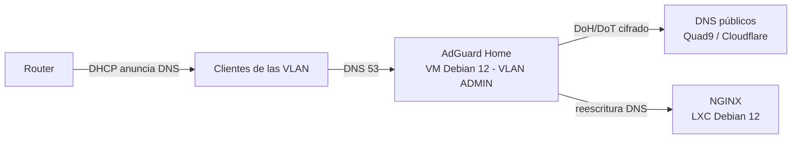

#tags: [wiki, homelab, red, dns, adguard, proxmox, vm] fecha: 2026-11-22 links: [[00 Indice]], [[02b NGINX en LXC Debian 12]], [[01b Equipamiento de red]], [[01a Recursos]], [[06 Monitoreo]], [[04 Almacenamiento]]

> [!info] Alcance Guía paso a paso para crear una **VM con Debian 12** en Proxmox VE 9.4 e instalar **AdGuard Home** como DNS interno y filtro de publicidad/rastreadores de la LAN. Es la primera herramienta de control de la VLAN de administración ([[01b Equipamiento de red#7. Otros equipos de administración de la LAN]]). Su compañera es [[02b NGINX en LXC Debian 12]].
> 
> **Convención:** los valores entre `<...>` o las IP de ejemplo (`192.168.10.x`, VLAN `10`) hay que adaptarlos a tu plan de direccionamiento. Leyenda: ✅ verificado · ⚠️ estimado · ❓ por verificar.

## Índice de esta nota

- [[#1. Objetivo y arquitectura]]
- [[#2. Datos previos y dimensionamiento]]
- [[#3. Crear la VM en Proxmox]]
    - [[#3.1 Subir la ISO de Debian 12]]
    - [[#3.2 Crear la VM por la interfaz web]]
    - [[#3.3 Alternativa por línea de comandos]]
- [[#4. Instalar Debian 12]]
- [[#5. Configuración inicial del sistema]]
- [[#6. Instalar AdGuard Home]]
- [[#6b. Alternativa - AdGuard Home con Docker Compose]]
  - [[#6b.1 Cuándo elegir Docker y cuándo el script]]
  - [[#6b.2 Instalar Docker Engine y Compose en Debian 12]]
  - [[#6b.3 Crear el archivo docker-compose.yml]]
  - [[#6b.4 Levantar el contenedor y hacer el asistente inicial]]
  - [[#6b.5 Operación diaria del contenedor]]
- [[#7. Configuración recomendada de AdGuard Home]]
- [[#8. Entregar el DNS a la LAN]]
- [[#9. Pruebas de funcionamiento]]
- [[#10. Respaldo y mantenimiento]]
- [[#11. Problemas frecuentes]]
- [[#12. Checklist y pendientes]]
- [[#Referencias]]

---

## 1. Objetivo y arquitectura

AdGuard Home es un servidor DNS que corre en tu red: todos los equipos le consultan los nombres de dominio, y él **bloquea** los dominios de publicidad/rastreo, **resuelve nombres internos** (por ejemplo `app.homelab.lan` → la IP de NGINX) y registra estadísticas.



> [!warning] Dependencia circular a tener en cuenta Si AdGuard corre como VM **en el servidor principal**, cuando ese servidor se apague o falle **la LAN se queda sin DNS** (y sin internet "de nombres"). Mitigaciones: arrancarlo primero (orden de inicio, ver [[#3.3 Alternativa por línea de comandos]]), tener un **segundo AdGuard** en otro equipo (por ejemplo el servidor de backup) y anunciarlo como DNS secundario ([[#8. Entregar el DNS a la LAN]]).

**Por qué una VM (y no un contenedor LXC):** la VM tiene su propio kernel, aislamiento total y se respalda/restaura como un disco completo; para un servicio tan crítico como el DNS es una elección razonable. A cambio consume más RAM (~1–2 GB) que un LXC (~100 MB). Si más adelante necesitás ahorrar recursos, AdGuard funciona igual de bien en un LXC.

## 2. Datos previos y dimensionamiento

|Dato|Valor de ejemplo|Notas|
|---|---|---|
|ID de la VM|`210`|Libre en tu nodo|
|Nombre / hostname|`adguard01`|FQDN opcional: `adguard01.homelab.lan`|
|vCPU|1–2|El DNS consume muy poca CPU|
|RAM|1–2 GB|AdGuard pide solo ~50 MB; el resto es SO y caché|
|Disco|16 GB (VirtIO SCSI)|Alcanza para SO + logs de consultas ([[01a Recursos#2.6 Disco]])|
|Red|Bridge `vmbr0`, VLAN `10` (ADMIN)|El bridge debe ser _VLAN-aware_ si usás etiqueta|
|IP|`192.168.10.53/24`, gateway `192.168.10.1`|**Fija**, o reserva DHCP en el router|
|Almacenamiento Proxmox|`local-zfs` (con ZFS)|Cambialo por el tuyo (`local-lvm`, etc.)|

**Puertos que usa AdGuard Home** (documentación oficial): `3000/TCP` solo durante la instalación inicial, `80/TCP` para la interfaz web y `53/UDP` (y TCP) para el servidor DNS. Si luego activás DNS cifrado se suman `853` (DoT/DoQ) y `443` (DoH).

## 3. Crear la VM en Proxmox

> [!note] Sobre la versión Proxmox VE 9 está basado en **Debian 13 "Trixie"** (el host), pero los **invitados** pueden ser Debian 12 sin problema. ❓ No pude confirmar las notas de la versión 9.4 concreta; los pasos son los de la rama 9.x. Si algún menú cambia de nombre, consultá `https://pve.proxmox.com/wiki/Roadmap`.

### 3.1 Subir la ISO de Debian 12

1. Descargá la ISO **netinst de Debian 12** (`debian-12.x.x-amd64-netinst.iso`). Como Debian 13 ya es la versión estable, las ISO de la 12 están en el archivo: `https://cdimage.debian.org/cdimage/archive/` (buscá la última 12.x). ❓ Verificá la URL vigente.
2. Verificá el checksum (`SHA256SUMS` en la misma carpeta).
3. En Proxmox: **tu nodo → local (storage) → ISO Images → Upload** y subí la ISO. (Alternativa: **Download from URL** pegando el enlace.)

> [!warning] Estado de soporte de Debian 12 Debian 12 "Bookworm" dejó el soporte regular de seguridad a mediados de 2026 y continúa con el soporte **LTS** (hasta mediados de 2028, según el calendario de Debian). ❓ Verificalo en `debian.org/releases`. Para instalaciones nuevas conviene evaluar Debian 13; los pasos de esta guía son prácticamente idénticos.

### 3.2 Crear la VM por la interfaz web

Botón **Create VM** (arriba a la derecha) y completar las pestañas:

|Pestaña|Valor|
|---|---|
|**General**|Node: tu nodo · VM ID: `210` · Name: `adguard01` · **Start at boot: ✔** · Start/Shutdown order: `order=1`, _Startup delay_ `30`|
|**OS**|ISO image: la ISO de Debian 12 · Type: Linux · Version: 6.x - 2.6 Kernel|
|**System**|Machine: `q35` (o _default_) · BIOS: _SeaBIOS_ (default) · SCSI Controller: **VirtIO SCSI single** · **Qemu Agent: ✔**|
|**Disks**|Bus: SCSI · Storage: `local-zfs` · Size: `16` GiB · **Discard ✔** · **SSD emulation ✔**|
|**CPU**|Sockets 1 · Cores `2` · Type: **host**|
|**Memory**|`2048` MiB (ballooning opcional)|
|**Network**|Bridge: `vmbr0` · Model: **VirtIO** · **VLAN Tag: `10`** · Firewall: ✔|

**Confirm** (sin marcar "Start after created" todavía si querés revisar antes).

### 3.3 Alternativa por línea de comandos

Desde la consola del nodo (como `root`). Ajustá almacenamiento, bridge, VLAN y nombre de la ISO:

```bash
qm create 210 --name adguard01 --ostype l26 \
  --cores 2 --cpu host --memory 2048 \
  --machine q35 --scsihw virtio-scsi-single \
  --scsi0 local-zfs:16,discard=on,ssd=1 \
  --net0 virtio,bridge=vmbr0,tag=10,firewall=1 \
  --ide2 local:iso/debian-12.x.x-amd64-netinst.iso,media=cdrom \
  --boot 'order=ide2;scsi0' \
  --agent enabled=1 \
  --onboot 1 --startup order=1,up=30

qm start 210
```

`--startup order=1,up=30` hace que esta VM arranque **primero** y espere 30 s antes de iniciar las siguientes (así el DNS ya existe cuando arrancan el resto de servicios).

## 4. Instalar Debian 12

Abrí la consola de la VM (**Console**) y elegí **Install** (no _Graphical_, da igual) con estas decisiones:

1. Idioma, país y teclado.
2. **Hostname:** `adguard01` · **Dominio:** `homelab.lan` (o el tuyo).
3. **Contraseña de root** (o vacía para que `sudo` quede en el usuario) y **usuario normal** (ej. `admin`).
4. **Red:** si el instalador detecta DHCP, aceptalo ahora y fijás la IP después ([[#5. Configuración inicial del sistema]]), o configurá la IP estática a mano.
5. **Particionado:** _Guiado - usar todo el disco_ → _Todos los archivos en una partición_.
6. **Selección de software:** **desmarcá** el entorno de escritorio y "GNOME"; **marcá** _servidor SSH_ y _utilidades estándar del sistema_.
7. Instalar GRUB en el disco principal y reiniciar. Al reiniciar, **quitá la ISO** (VM → Hardware → CD/DVD → _Do not use any media_) para no volver a arrancar el instalador.

## 5. Configuración inicial del sistema

Entrá por SSH desde la PC administradora (`ssh admin@<IP>`).

```bash
# 1. Actualizar y herramientas básicas
sudo apt update && sudo apt full-upgrade -y
sudo apt install -y qemu-guest-agent curl dnsutils ca-certificates unattended-upgrades
sudo systemctl enable --now qemu-guest-agent

# 2. Zona horaria
sudo timedatectl set-timezone America/Argentina/Buenos_Aires
```

**IP estática** (Debian con `ifupdown`: editá `/etc/network/interfaces`; el nombre de la interfaz puede ser `ens18`, verificalo con `ip -br a`):

```text
auto ens18
iface ens18 inet static
    address 192.168.10.53/24
    gateway 192.168.10.1
```

El DNS de la propia VM se define en `/etc/resolv.conf` (lo escribe el instalador). Mientras AdGuard no esté instalado, dejá un resolvedor externo (`nameserver 9.9.9.9`) para poder descargar paquetes; al terminar podés apuntarlo al propio AdGuard, pero conservá un respaldo para que la VM pueda actualizarse aunque el servicio DNS esté caído.

```bash
sudo systemctl restart networking   # o reiniciar la VM
ip -br a
```

> [!tip] Alternativa En lugar de IP estática en la VM podés dejar DHCP y crear una **reserva por MAC** en el router (VLAN ADMIN). Lo importante es que la IP del DNS **nunca cambie**.

**Actualizaciones automáticas de seguridad** (opcional, recomendado):

```bash
sudo dpkg-reconfigure -plow unattended-upgrades
```

**Comprobá que el puerto 53 esté libre** (AdGuard lo necesita):

```bash
sudo ss -lntup | grep ':53 '
```

Si no devuelve nada, seguí. En una instalación mínima de Debian 12 con `ifupdown` normalmente **no** hay `systemd-resolved` ocupando el puerto. Si aparece, ver [[#11. Problemas frecuentes]].

**Seguridad básica:** autenticación SSH por clave y sin login de `root`:

```bash
# desde la PC administradora
ssh-copy-id admin@192.168.10.53
# en la VM: en /etc/ssh/sshd_config
#   PermitRootLogin no
#   PasswordAuthentication no   (solo después de comprobar que entrás con clave)
sudo systemctl reload ssh
```

## 6. Instalar AdGuard Home

Se usa el **script de instalación oficial** del proyecto, que descarga el binario a `/opt/AdGuardHome` y lo registra como servicio de systemd.

> [!warning] Revisá el script antes de ejecutarlo Ejecutar `curl | sh` como root da control total de la máquina. Descargalo, leelo y recién después ejecutalo.

```bash
cd /tmp
curl -sSL https://raw.githubusercontent.com/AdguardTeam/AdGuardHome/master/scripts/install.sh -o agh-install.sh
less agh-install.sh                 # revisar
sudo sh agh-install.sh -v           # -v = salida detallada
```

Verificá el servicio:

```bash
sudo systemctl status AdGuardHome
sudo ss -lntup | grep -e ':53 ' -e ':3000'
```

**Asistente inicial** (solo la primera vez): desde tu PC abrí `http://192.168.10.53:3000` y seguí los pasos:

1. **Get Started.**
2. _Admin Web Interface_: interfaz de escucha = la IP de la VM (`192.168.10.53`), puerto **80** (o el que prefieras, ej. 8080 si luego proxyeás con NGINX).
3. _DNS server_: interfaz = la IP de la VM, puerto **53**. Evitá "todas las interfaces" salvo que lo necesites.
4. Crear **usuario y contraseña** del panel (fuerte y única).
5. Finalizar. A partir de ahora el panel queda en `http://192.168.10.53` y el puerto 3000 deja de usarse.

Comandos útiles del servicio (el binario se gestiona a sí mismo):

```bash
sudo /opt/AdGuardHome/AdGuardHome -s status
sudo /opt/AdGuardHome/AdGuardHome -s restart
# configuración: /opt/AdGuardHome/AdGuardHome.yaml
```

## 6b. Alternativa - AdGuard Home con Docker Compose

> [!info] Una sola opción por VM
> Esta sección es **alternativa** a la sección 6 (script oficial). Elegí una de las dos: ambas usan el puerto 53 y no pueden convivir en la misma VM. A partir de la sección 7 el resto de la guía (configuración, DHCP, pruebas) es igual para las dos opciones.

### 6b.1 Cuándo elegir Docker y cuándo el script

| Criterio | Script oficial (sección 6) | Docker Compose (esta sección) |
|---|---|---|
| Instalación | Un binario en `/opt/AdGuardHome` y un servicio systemd | Contenedor `adguard/adguardhome` descrito en un `docker-compose.yml` |
| Actualizar | Desde el panel o repitiendo el script | `docker compose pull && docker compose up -d` |
| Respaldar | `AdGuardHome.yaml` + carpeta `data` | Carpetas `conf` y `work` junto al `docker-compose.yml` |
| Reproducibilidad | Media | **Alta**: el archivo compose documenta toda la instalación |
| Consumo | Mínimo | Algo mayor (motor de Docker, ~100-200 MB de RAM) |
| Conviene si... | La VM solo hará DNS | La VM va a alojar más servicios en contenedores, o querés una instalación fácil de replicar |

### 6b.2 Instalar Docker Engine y Compose en Debian 12

Se usa el repositorio oficial de Docker (el paquete `docker.io` de Debian suele ir más atrás). Como usuario con `sudo` en la VM:

```bash
# 1. Requisitos y clave del repositorio
sudo apt update
sudo apt install -y ca-certificates curl
sudo install -m 0755 -d /etc/apt/keyrings
sudo curl -fsSL https://download.docker.com/linux/debian/gpg -o /etc/apt/keyrings/docker.asc
sudo chmod a+r /etc/apt/keyrings/docker.asc

# 2. Agregar el repositorio (Debian 12 = "bookworm")
echo "deb [arch=$(dpkg --print-architecture) signed-by=/etc/apt/keyrings/docker.asc] \
https://download.docker.com/linux/debian $(. /etc/os-release && echo "$VERSION_CODENAME") stable" \
  | sudo tee /etc/apt/sources.list.d/docker.list > /dev/null

# 3. Instalar el motor y el plugin de Compose
sudo apt update
sudo apt install -y docker-ce docker-ce-cli containerd.io docker-buildx-plugin docker-compose-plugin

# 4. Verificar
sudo systemctl status docker --no-pager
docker --version
docker compose version
```

> [!warning] Verificá las instrucciones vigentes
> Los pasos pueden cambiar (por ejemplo, el formato del archivo del repositorio). ❓ Comparalos con `https://docs.docker.com/engine/install/debian/` antes de ejecutar.

> [!note] Permisos
> Si agregás tu usuario al grupo `docker` (`sudo usermod -aG docker admin`), ese usuario podrá ejecutar Docker sin `sudo`, pero equivale a tener acceso **root** sobre la VM. En una VM de administración conviene seguir usando `sudo docker ...`.

### 6b.3 Crear el archivo docker-compose.yml

Usá una carpeta propia (distinta de `/opt/AdGuardHome`, que usa el script):

```bash
sudo mkdir -p /opt/adguard-docker/{conf,work}
cd /opt/adguard-docker
sudo nano docker-compose.yml
```

Contenido (reemplazá `192.168.10.53` por la IP fija de tu VM):

```yaml
services:
  adguardhome:
    image: adguard/adguardhome:latest
    container_name: adguardhome
    restart: unless-stopped
    ports:
      # DNS (TCP y UDP) - solo en la IP de la VM
      - "192.168.10.53:53:53/tcp"
      - "192.168.10.53:53:53/udp"
      # Panel web
      - "192.168.10.53:80:80/tcp"
      # Asistente inicial (se puede quitar al terminar la configuración)
      - "192.168.10.53:3000:3000/tcp"
      # Opcional: DNS cifrado (descomentar solo si lo vas a usar)
      # - "192.168.10.53:853:853/tcp"    # DNS-over-TLS
      # - "192.168.10.53:853:853/udp"    # DNS-over-QUIC
      # - "192.168.10.53:443:443/tcp"    # DNS-over-HTTPS
      # - "192.168.10.53:443:443/udp"
    volumes:
      - ./work:/opt/adguardhome/work    # datos: estadísticas, registro de consultas, filtros
      - ./conf:/opt/adguardhome/conf    # configuración: AdGuardHome.yaml
    logging:
      driver: json-file
      options:
        max-size: "10m"
        max-file: "3"
```

Qué hace cada parte:

| Elemento | Para qué sirve |
|---|---|
| `image: adguard/adguardhome` | Imagen oficial de AdGuard Home en Docker Hub. Para evitar sorpresas al actualizar, podés fijar una versión concreta en lugar de `latest` (ej. `adguard/adguardhome:v0.107.xx`; ❓ verificá la etiqueta vigente en Docker Hub) |
| `restart: unless-stopped` | El contenedor arranca solo con la VM y se reinicia si falla |
| `ports` con IP delante | Publica los puertos **solo en la IP de la VM** (no en todas las interfaces) |
| `volumes` | Guarda configuración y datos **fuera** del contenedor: sobreviven a las actualizaciones |
| `logging` | Limita el tamaño de los logs de Docker para que no llenen el disco |

> [!warning] Docker y el firewall de la VM
> Docker publica los puertos modificando las reglas de red (`iptables`/`nftables`) y **puede saltarse** reglas de `ufw`. No confíes en `ufw` para restringir estos puertos: limitá el acceso con las reglas del router entre VLAN ([[#8. Entregar el DNS a la LAN]]) y con la IP delante del puerto en el `ports`.

> [!tip] Variante con red del host
> Si preferís que el contenedor use la red de la VM directamente (por ejemplo, para activar el servidor DHCP de AdGuard), reemplazá el bloque `ports` por `network_mode: host`. En ese modo no se publican puertos: el asistente y el panel escuchan según lo que configures. Para un DNS que solo responde consultas **no es necesario**.

### 6b.4 Levantar el contenedor y hacer el asistente inicial

**Antes de levantar:** el puerto 53 debe estar libre en la VM (ver [[#5. Configuración inicial del sistema]] y [[#11. Problemas frecuentes]]).

```bash
cd /opt/adguard-docker
sudo docker compose config          # valida la sintaxis del YAML
sudo docker compose up -d           # descarga la imagen y arranca en segundo plano
sudo docker compose ps              # el estado debe ser "running"
sudo docker compose logs -f         # ver el arranque (salir con Ctrl+C)
sudo ss -lntup | grep -e ':53 ' -e ':3000 '
```

**Asistente inicial:** desde tu PC abrí `http://192.168.10.53:3000` y seguí estos pasos. Dentro del contenedor hay que dejar los puertos estándar:

1. **Get Started.**
2. *Admin Web Interface*: interfaz **All interfaces**, puerto **80** (el contenedor lo expone en la IP de la VM por el `ports`).
3. *DNS server*: interfaz **All interfaces**, puerto **53**.
4. Crear **usuario y contraseña** del panel (fuertes y únicas).
5. Finalizar. El panel queda en `http://192.168.10.53`.

> [!note]
> "All interfaces" se refiere a las interfaces **dentro del contenedor**. Desde afuera, quien decide en qué IP se escucha es la IP que pusiste delante de cada puerto en el `docker-compose.yml`.

Cuando el asistente termine, podés **cerrar el puerto 3000**: quitá esa línea del `ports` y aplicá el cambio con `sudo docker compose up -d`.

La configuración recomendada (upstream cifrado, control de acceso, DNS rewrites, retención de logs) es la de la [[#7. Configuración recomendada de AdGuard Home]], sin cambios.

### 6b.5 Operación diaria del contenedor

| Tarea | Comando (desde `/opt/adguard-docker`) |
|---|---|
| Ver estado | `sudo docker compose ps` |
| Ver logs | `sudo docker compose logs -f --tail 100` |
| Reiniciar | `sudo docker compose restart` |
| Detener | `sudo docker compose stop` |
| **Actualizar** a la última imagen | `sudo docker compose pull && sudo docker compose up -d` |
| Limpiar imágenes viejas | `sudo docker image prune -f` |
| Entrar a una shell del contenedor | `sudo docker compose exec adguardhome sh` |

**Respaldo:** hacé una copia de la carpeta `/opt/adguard-docker` entera (contiene el `docker-compose.yml`, `conf/AdGuardHome.yaml` y `work/`). Para restaurar en otra VM alcanza con copiar la carpeta y ejecutar `sudo docker compose up -d`.

**Snapshot antes de actualizar:** igual que en la guía principal, tomá un snapshot de la VM en Proxmox antes de una actualización mayor ([[#10. Respaldo y mantenimiento]]).
## 7. Configuración recomendada de AdGuard Home

Todo desde el panel web.

**DNS upstream (Settings → DNS settings)**

- _Upstream DNS servers_ (cifrados): por ejemplo `https://dns.quad9.net/dns-query` y `https://cloudflare-dns.com/dns-query`. Elegí los que prefieras en privacidad/filtrado.
- _Bootstrap DNS_: `9.9.9.9` y `1.1.1.1` (para resolver el nombre del upstream al arrancar).
- _Upstream mode_: **Parallel requests** (más rápido).
- _Rate limit_: valor razonable (por defecto 20/s por cliente); ajustalo si algún servicio hace ráfagas.

**Control de acceso (Settings → DNS settings → Access settings)**

- _Allowed clients_: **solo tus redes**, por ejemplo `192.168.0.0/16`. Así tu AdGuard nunca actúa como resolvedor abierto aunque un puerto quede expuesto.

**Filtros (Filters → DNS blocklists)**

- Dejá la lista por defecto y sumá alguna adicional si querés más bloqueo. Más listas = más RAM y más falsos positivos; empezá poco.

**Nombres internos (Filters → DNS rewrites)**

Es la función que une esta nota con [[02b NGINX en LXC Debian 12]]: apuntá los nombres de tus servicios a la **IP de NGINX**, que luego los enruta.

|Dominio|Respuesta|
|---|---|
|`app.homelab.lan`|`192.168.10.80` (IP de NGINX)|
|`*.apps.homelab.lan`|`192.168.10.80`|
|`proxmox.homelab.lan`|IP del nodo (solo accesible desde ADMIN)|

**Dominio local y DNS inverso:** en _Settings → DNS settings → Private reverse DNS servers_ podés indicar el router para que los nombres de dispositivos aparezcan en el registro.

**Registro de consultas (Settings → General settings)**

- _Query logs retention_: 7–30 días y _Statistics retention_ acorde. Los logs crecen ([[01a Recursos#2.6 Disco]]); definí retención desde el inicio.

**Opcional:** modo de bloqueo, protección de navegación/búsqueda segura, servicios bloqueables por cliente (útil para la VLAN INVITADOS u HOGAR).

## 8. Entregar el DNS a la LAN

AdGuard solo sirve si los clientes lo usan. Hay que decírselo vía **DHCP en el router** (por cada VLAN):

|VLAN|DNS que anuncia el DHCP|Notas|
|---|---|---|
|ADMIN|`192.168.10.53`|El propio servidor mantiene `127.0.0.1` o el router como DNS|
|HOGAR|`192.168.10.53`||
|APPS / DMZ|`192.168.10.53`|Los servidores necesitan resolver nombres internos|
|INVITADOS|`192.168.10.53`|Permitir solo DNS hacia AdGuard y salida a internet|
|BACKUP|`192.168.10.53` o ninguno|Según si necesita resolver nombres|

**DNS secundario:** si anunciás un DNS **público** (1.1.1.1) como secundario, muchos clientes lo usarán y **saltarán el filtrado**. Si querés redundancia, poné un **segundo AdGuard** (otra VM/otro equipo) con la misma configuración y anunciá ambos.

**Reglas de firewall del router entre VLAN** (política _default deny_, ver [[01b Equipamiento de red#3. Router y firewall]]):

|Origen|Destino|Puerto|Acción|
|---|---|---|---|
|Todas las VLAN de clientes|`192.168.10.53`|UDP/TCP 53|Permitir|
|Todas las VLAN de clientes|`192.168.10.53`|TCP 80 (panel)|**Solo desde ADMIN**|
|VLAN clientes|Internet|UDP/TCP 53 y TCP 853|**Bloquear** (evita DNS alternativo)|
|AdGuard|Internet|TCP 443 / 853|Permitir (upstream cifrado)|

> [!note] Límite del bloqueo de DNS externo Los clientes que usan **DoH** (DNS sobre HTTPS, ej. algunos navegadores) viajan por 443 y no se bloquean con reglas de puerto 53/853. Se controlan con la política del navegador o bloqueando listas de resolvedores DoH.

La sintaxis concreta de DHCP y reglas depende de tu router (TP-Link Omada u otro) y va en la configuración de red de la pregunta 2.

## 9. Pruebas de funcionamiento

Desde un equipo de la LAN (o la propia VM):

```bash
# 1. Resolución normal vía AdGuard
dig @192.168.10.53 example.com +short

# 2. Un dominio de publicidad debe bloquearse (0.0.0.0 o NXDOMAIN según el modo)
dig @192.168.10.53 doubleclick.net +short

# 3. Nombre interno reescrito
dig @192.168.10.53 app.homelab.lan +short     # debe devolver la IP de NGINX

# 4. Desde un cliente, confirmar que usa AdGuard
nslookup example.com                          # el "Server" debe ser 192.168.10.53
```

En el panel: **Query Log** debe mostrar las consultas del cliente. Checklist:

- [ ] El servicio `AdGuardHome` está activo y arranca solo (`systemctl is-enabled AdGuardHome`)
- [ ] La VM arranca sola con Proxmox (`Start at boot`) y en primer orden
- [ ] Un cliente por DHCP recibe el DNS correcto
- [ ] Un dominio de publicidad queda bloqueado y uno normal resuelve
- [ ] Los nombres internos resuelven a NGINX
- [ ] Desde una VLAN no autorizada **no** se llega al panel (puerto 80)

## 10. Respaldo y mantenimiento

- **Backup de la VM:** Proxmox → **Datacenter → Backup → Add** (job con `vzdump`) o Proxmox Backup Server; en modo _snapshot_, frecuencia diaria/semanal. La estrategia completa va en la pregunta 5 (pendiente).
- **Snapshot antes de actualizar:** VM → **Snapshots → Take Snapshot** antes de cada actualización mayor.
- **Backup de la configuración:** copiá `/opt/AdGuardHome/AdGuardHome.yaml` y el directorio `data` (contiene listas y estadísticas) a tu repositorio de configuraciones.
- **Actualizar AdGuard Home:** desde el panel (aviso de nueva versión) o volviendo a ejecutar el script de instalación. Actualizá el sistema con `sudo apt update && sudo apt full-upgrade`.
- **Monitoreo:** vigilá que el servicio responda a consultas DNS ([[06 Monitoreo]]); un DNS caído "rompe" todo lo demás aunque los servidores estén bien.

## 11. Problemas frecuentes

|Síntoma|Causa probable|Solución|
|---|---|---|
|El asistente dice que el puerto 53 está en uso|`systemd-resolved` u otro servicio ocupa el 53|`sudo ss -lntup \| grep ':53 '`; si es `systemd-resolved`, deshabilitar el _DNSStubListener_ (crear `/etc/systemd/resolved.conf.d/adguardhome.conf` con `DNSStubListener=no`, reiniciar `systemd-resolved` y apuntar `/etc/resolv.conf` a `/run/systemd/resolve/resolv.conf`)|
|No abre `http://IP:3000`|Firewall de Proxmox/router, o servicio detenido|Verificar `systemctl status AdGuardHome`, VLAN y reglas|
|Los clientes no usan AdGuard|El DHCP sigue anunciando otro DNS|Revisar DHCP por VLAN; renovar lease en el cliente|
|Todo "se rompe" cuando se reinicia el servidor|DNS en una VM del mismo host|Orden de inicio + segundo AdGuard ([[#1. Objetivo y arquitectura]])|
|Un sitio legítimo no carga|Falso positivo de una lista de bloqueo|En _Query Log_ → "Unblock", o agregar regla de excepción|
|Los nombres internos no resuelven|Falta el _DNS rewrite_ o el cliente usa otro DNS|Revisar _Filters → DNS rewrites_ y el DNS del cliente|
|La VM no responde tras mover la VLAN|El bridge no es VLAN-aware o el _tag_ es incorrecto|Revisar `vmbr0 → VLAN aware` y el tag de la NIC|

## 12. Checklist y pendientes

- [ ] Reemplazar las IP/VLAN de ejemplo por las definitivas
- [ ] ❓ Confirmar URL y versión de la ISO Debian 12 (o decidir pasar a Debian 13)
- [ ] ❓ Confirmar el comportamiento de los menús en Proxmox VE 9.4 exacta
- [ ] Crear segundo AdGuard (redundancia) en otro equipo
- [ ] Documentar DHCP y reglas de firewall en la nota de red de la pregunta 2
- [ ] Incluir la VM en el job de backup y probar una restauración

## Referencias

- AdGuard Home - Getting Started (wiki oficial): `https://github.com/AdguardTeam/AdGuardHome/wiki/Getting-Started` y su Knowledge Base en `adguard-dns.io/kb/adguard-home/getting-started/`
- Proxmox VE - documentación y _Roadmap_: `https://pve.proxmox.com/pve-docs` · `https://pve.proxmox.com/wiki/Roadmap`
- Notas relacionadas: [[00 Indice]] · [[02b NGINX en LXC Debian 12]] · [[01b Equipamiento de red]] · [[03 Hipervisor]] · [[06 Monitoreo]]