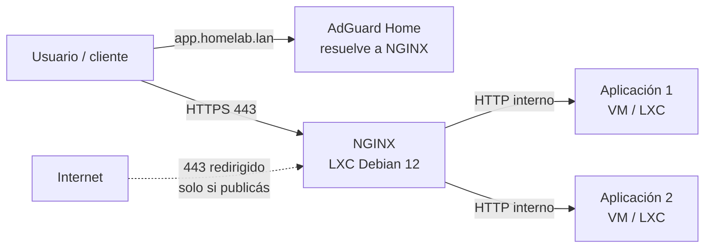

tags: [wiki, homelab, red, nginx, proxy-inverso, proxmox, lxc] fecha: 2026-11-22 links: [[00 Indice]], [[02a AdGuard Home en VM Debian 12]], [[01b Equipamiento de red]], [[01a Recursos]], [[06 Monitoreo]], [[04 Almacenamiento]]


> [!info] Alcance Guía paso a paso para crear un **contenedor LXC con Debian 12** en Proxmox VE 9.4 e instalar **NGINX** como **proxy inverso**: un único punto de entrada web que recibe las peticiones por nombre (`app.homelab.lan`) y las reenvía a la VM o contenedor correcto, con HTTPS. Se apoya en los _DNS rewrites_ de [[02a AdGuard Home en VM Debian 12]]. Leyenda: ✅ verificado · ⚠️ estimado · ❓ por verificar. Las IP, VLAN e IDs son ejemplos a adaptar.

## Índice de esta nota

- [[#1. Objetivo y arquitectura]]
- [[#2. Datos previos y dimensionamiento]]
- [[#3. Crear el contenedor LXC]]
    - [[#3.1 Descargar la plantilla Debian 12]]
    - [[#3.2 Crear el CT por la interfaz web]]
    - [[#3.3 Alternativa por línea de comandos]]
- [[#4. Configuración inicial del contenedor]]
- [[#5. Instalar NGINX]]
- [[#6. Configurar un proxy inverso]]
- [[#7. HTTPS y certificados]]
- [[#8. Seguridad]]
- [[#9. Logs y monitoreo]]
- [[#10. Respaldo y mantenimiento]]
- [[#11. Pruebas de funcionamiento]]
- [[#12. Problemas frecuentes]]
- [[#13. Checklist y pendientes]]
- [[#Referencias]]

---

## 1. Objetivo y arquitectura



**Qué aporta:** un solo punto para certificados TLS, nombres legibles, filtrado de accesos, límites de tasa y registro centralizado de las peticiones web (útil para medir el tiempo de respuesta R del dimensionamiento, ver [[01a Recursos#2.2 Usuarios a peticiones y workers]]).

**Por qué un LXC:** NGINX es liviano; un contenedor usa una fracción de la RAM de una VM y arranca en segundos.

> [!warning] ¿En qué VLAN va NGINX? Tus notas lo ubican en la **VLAN ADMIN** ([[01b Equipamiento de red#7. Otros equipos de administración de la LAN]]). Si solo publica aplicaciones **internas**, ADMIN es válido; si va a recibir tráfico desde **internet**, lo habitual es ponerlo en la **DMZ**, para que un compromiso del proxy no tenga alcance directo a la red de administración. Esta guía funciona igual en ambos casos: solo cambian el _tag_ de VLAN, la IP y las reglas de firewall. Decidilo al diseñar el firewall (pregunta 2).

**Límite del proxy:** NGINX no protege por sí solo la aplicación de destino; las interfaces de administración (Proxmox, TrueNAS, paneles) **no deben publicarse en internet** ([[04 Almacenamiento#5. Seguridad - checklist mínimo]]).

## 2. Datos previos y dimensionamiento

|Dato|Valor de ejemplo|Notas|
|---|---|---|
|ID del CT|`220`|Libre en tu nodo|
|Hostname|`nginx01`||
|Tipo|**Sin privilegios (_unprivileged_) ✔**|Más seguro; NGINX no necesita privilegios|
|vCPU|1 (2 si hay mucho TLS)|⚠️ El TLS y el proxy consumen poca CPU|
|RAM|512 MB–1 GB; _swap_ 512 MB|Coincide con la propuesta de [[01a Recursos#4. Reparto de recursos por servicio (64 GB)]] (0,5–1 GB)|
|Disco raíz|8 GB|Los logs de acceso son lo que crece: ver [[01a Recursos#2.6 Disco]]|
|Red|`vmbr0`, VLAN `10`, IP `192.168.10.80/24`, GW `192.168.10.1`|IP fija|
|DNS del CT|`192.168.10.53` (AdGuard)||
|Puertos de NGINX|`80/TCP` (redirige a HTTPS) y `443/TCP`||

## 3. Crear el contenedor LXC

### 3.1 Descargar la plantilla Debian 12

**Por la web:** nodo → **local (storage) → CT Templates → Templates** → buscá `debian-12-standard` → **Download**.

**Por consola:**

```bash
pveam update
pveam available --section system | grep debian-12
pveam download local debian-12-standard_12.x-x_amd64.tar.zst   # usá el nombre exacto listado
pveam list local
```

> [!warning] Estado de soporte de Debian 12 Debian 13 es la versión estable actual y Debian 12 está en soporte **LTS** (❓ verificá fechas en `debian.org/releases`). Si no aparece la plantilla `debian-12-standard` en tu catálogo, usá la de Debian 13; los pasos son los mismos. Proxmox VE 9 usa Debian 13 en el host, pero los contenedores pueden ser de otra versión de Debian.

### 3.2 Crear el CT por la interfaz web

Botón **Create CT** y completar:

|Pestaña|Valor|
|---|---|
|**General**|Node · CT ID `220` · Hostname `nginx01` · **Unprivileged container ✔** · contraseña de root o **clave SSH pública**|
|**Template**|Storage `local` · Template `debian-12-standard_…`|
|**Disks**|Storage `local-zfs` · Disk size `8` GiB|
|**CPU**|Cores `1`|
|**Memory**|Memory `1024` MiB · Swap `512` MiB|
|**Network**|Name `eth0` · Bridge `vmbr0` · **VLAN Tag `10`** · IPv4 **Static** `192.168.10.80/24` · Gateway `192.168.10.1` · Firewall ✔|
|**DNS**|DNS servers `192.168.10.53` · DNS domain `homelab.lan`|

Al terminar, en **Options** del CT activá **Start at boot ✔** y _Start/Shutdown order_ `2` con _delay_ `15` (arranca después del DNS).

### 3.3 Alternativa por línea de comandos

```bash
pct create 220 local:vztmpl/debian-12-standard_12.x-x_amd64.tar.zst \
  --hostname nginx01 --unprivileged 1 \
  --cores 1 --memory 1024 --swap 512 \
  --rootfs local-zfs:8 \
  --net0 name=eth0,bridge=vmbr0,tag=10,ip=192.168.10.80/24,gw=192.168.10.1,firewall=1 \
  --nameserver 192.168.10.53 --searchdomain homelab.lan \
  --features nesting=0 \
  --onboot 1 --startup order=2,up=15 \
  --ssh-public-keys /root/.ssh/id_ed25519.pub

pct start 220
pct enter 220        # shell dentro del contenedor desde el host
```

(Ajustá el nombre exacto de la plantilla, el almacenamiento y la ruta de la clave.)

## 4. Configuración inicial del contenedor

```bash
# Dentro del CT (como root)
apt update && apt full-upgrade -y
apt install -y curl ca-certificates openssl sudo unattended-upgrades
timedatectl set-timezone America/Argentina/Buenos_Aires   # si no funciona en LXC: dpkg-reconfigure tzdata

# Usuario administrador con sudo
adduser admin
usermod -aG sudo admin
```

Configurá el acceso por **clave SSH** (el servicio SSH de la plantilla puede requerir instalación: `apt install -y openssh-server`) y deshabilitá el login de root por contraseña en `/etc/ssh/sshd_config` (`PermitRootLogin prohibit-password` o `no`), igual que en [[02a AdGuard Home en VM Debian 12#5. Configuración inicial del sistema]].

Comprobá red y DNS:

```bash
ip -br a
ping -c2 192.168.10.1
getent hosts debian.org          # resuelve vía AdGuard
```

## 5. Instalar NGINX

Se instala el paquete de Debian (versión 1.22.x en Debian 12), estable y con parches de seguridad de la distribución.

```bash
apt install -y nginx
systemctl enable --now nginx
nginx -v
systemctl status nginx --no-pager
curl -I http://127.0.0.1          # debe responder 200 OK (página por defecto)
```

Estructura de archivos de Debian:

|Ruta|Para qué|
|---|---|
|`/etc/nginx/nginx.conf`|Configuración global|
|`/etc/nginx/conf.d/*.conf`|Configuración global adicional (mapas, formatos de log)|
|`/etc/nginx/sites-available/`|Un archivo por sitio (borrador)|
|`/etc/nginx/sites-enabled/`|Enlaces simbólicos a los sitios activos|
|`/etc/nginx/snippets/`|Fragmentos reutilizables|
|`/var/log/nginx/`|`access.log` y `error.log`|

Flujo de trabajo siempre igual: **editar → probar → recargar**:

```bash
nginx -t && systemctl reload nginx
```

## 6. Configurar un proxy inverso

Ejemplo: publicar una aplicación interna que escucha en `http://192.168.30.20:8080` bajo el nombre `app.homelab.lan`.

**Paso 1 - Mapa de WebSocket** (una sola vez), `/etc/nginx/conf.d/websocket.conf`:

```nginx
map $http_upgrade $connection_upgrade {
    default upgrade;
    ''      close;
}
```

**Paso 2 - Fragmento común**, `/etc/nginx/snippets/proxy-common.conf`:

```nginx
proxy_http_version 1.1;
proxy_set_header Host              $host;
proxy_set_header X-Real-IP         $remote_addr;
proxy_set_header X-Forwarded-For   $proxy_add_x_forwarded_for;
proxy_set_header X-Forwarded-Proto $scheme;
proxy_set_header Upgrade           $http_upgrade;
proxy_set_header Connection        $connection_upgrade;
proxy_connect_timeout 5s;
proxy_read_timeout    60s;
```

**Paso 3 - Sitio**, `/etc/nginx/sites-available/app.homelab.lan`:

```nginx
server {
    listen 80;
    server_name app.homelab.lan;
    return 301 https://$host$request_uri;
}

server {
    listen 443 ssl http2;
    server_name app.homelab.lan;

    ssl_certificate     /etc/nginx/ssl/app.homelab.lan.crt;
    ssl_certificate_key /etc/nginx/ssl/app.homelab.lan.key;

    client_max_body_size 50m;          # subir si la app recibe archivos grandes (ej. nube de archivos)

    location / {
        proxy_pass http://192.168.30.20:8080;
        include snippets/proxy-common.conf;
    }
}
```

> [!note] Sobre `http2` La forma `listen 443 ssl http2;` es la de NGINX 1.22 (Debian 12). En versiones 1.25.1 y posteriores se prefiere la directiva separada `http2 on;` y la anterior aparece como obsoleta.

**Paso 4 - Activar:**

```bash
ln -s /etc/nginx/sites-available/app.homelab.lan /etc/nginx/sites-enabled/
rm -f /etc/nginx/sites-enabled/default        # quitar el sitio por defecto
mkdir -p /etc/nginx/ssl                        # certificados: sección 7
nginx -t && systemctl reload nginx
```

**Paso 5 - DNS interno:** en AdGuard Home, _Filters → DNS rewrites_: `app.homelab.lan` → `192.168.10.80` ([[02a AdGuard Home en VM Debian 12#7. Configuración recomendada de AdGuard Home]]).

**Servidor por defecto** (devuelve error a quien consulte por IP o por un nombre no configurado):

```nginx
# /etc/nginx/conf.d/00-default.conf
server {
    listen 80 default_server;
    listen 443 ssl default_server;
    ssl_reject_handshake on;       # no necesita certificado
    return 444;                    # cierra la conexión sin respuesta
}
```

## 7. HTTPS y certificados

Hay tres caminos según el caso:

|Caso|Solución|Notas|
|---|---|---|
|Solo red interna, sin dominio público|**Certificado autofirmado** o de una **CA propia**|El navegador avisa salvo que instales la CA en los clientes|
|Dominio público propio, servicios internos|**Let's Encrypt con desafío DNS-01**|No exige abrir puertos; depende del proveedor de DNS del dominio|
|Servicio publicado en internet|**Let's Encrypt con HTTP-01** (certbot)|Requiere que 80/443 lleguen a NGINX (redirección de puertos en el router)|

**A) Autofirmado (para empezar y probar):**

```bash
openssl req -x509 -nodes -newkey rsa:2048 -days 825 \
  -keyout /etc/nginx/ssl/app.homelab.lan.key \
  -out    /etc/nginx/ssl/app.homelab.lan.crt \
  -subj "/CN=app.homelab.lan" \
  -addext "subjectAltName=DNS:app.homelab.lan"
chmod 600 /etc/nginx/ssl/app.homelab.lan.key
nginx -t && systemctl reload nginx
```

**B) Let's Encrypt con certbot (sitio publicado):**

```bash
apt install -y certbot python3-certbot-nginx
certbot --nginx -d sitio.tudominio.com
systemctl list-timers | grep certbot        # renovación automática
certbot renew --dry-run
```

**Ajustes TLS recomendados**, `/etc/nginx/snippets/tls-params.conf` (incluir con `include snippets/tls-params.conf;` dentro de cada `server` de 443):

```nginx
ssl_protocols TLSv1.2 TLSv1.3;
ssl_session_cache shared:SSL:10m;
ssl_session_timeout 1d;
# HSTS: activarlo solo cuando el HTTPS esté estable y definitivo
# add_header Strict-Transport-Security "max-age=31536000" always;
```

## 8. Seguridad

- **Ocultar la versión:** en `/etc/nginx/nginx.conf`, dentro de `http { }`: `server_tokens off;`
    
- **Limitar el acceso por red** a aplicaciones sensibles:
    
    ```nginx
    location / {
        allow 192.168.10.0/24;      # solo la VLAN ADMIN
        deny  all;
        proxy_pass http://192.168.30.20:8080;
        include snippets/proxy-common.conf;
    }
    ```
    
- **Limitar ráfagas** (ejemplo por IP, en `http { }` y dentro del `location`):
    
    ```nginx
    # conf.d: limit_req_zone $binary_remote_addr zone=porip:10m rate=10r/s;
    # location: limit_req zone=porip burst=20 nodelay;
    ```
    
- **Permisos de claves privadas:** `chmod 600`, propietario `root`.
    
- **Firewall:** en el router (reglas entre VLAN) y el firewall de Proxmox (CT → **Firewall**): permitir solo `80/443` hacia NGINX desde las VLAN que correspondan, y desde NGINX solo hacia los puertos de las aplicaciones destino. Política _default deny_ ([[01b Equipamiento de red#3. Router y firewall]]).
    
- **Actualizaciones:** `unattended-upgrades` activo y `apt update && apt full-upgrade` periódico.
    
- **Interfaces de administración** (Proxmox, TrueNAS, router): **nunca** detrás de un proxy público. Acceso por VPN/VLAN ADMIN.
    

## 9. Logs y monitoreo

**Formato de log con tiempo de respuesta** (útil para medir **R** del dimensionamiento, [[01a Recursos#2.9 Cómo medir cada dato]]). En `/etc/nginx/conf.d/log-format.conf`:

```nginx
log_format timed '$remote_addr - $remote_user [$time_local] "$request" '
                 '$status $body_bytes_sent "$http_referer" "$http_user_agent" '
                 'urt=$upstream_response_time $request_time';
```

Y en cada sitio (`server { }`): `access_log /var/log/nginx/app.homelab.lan.access.log timed;`

Con `$request_time` como **último campo**, el promedio sale con:

```bash
awk '{s+=$NF;n++} END{print s/n " s promedio, " n " peticiones"}' /var/log/nginx/app.homelab.lan.access.log
```

**Estado de NGINX para monitoreo** (solo accesible localmente):

```nginx
server {
    listen 127.0.0.1:8081;
    location /nginx_status {
        stub_status;
        allow 127.0.0.1;
        deny all;
    }
}
```

Esto permite que un colector de métricas lea conexiones activas y peticiones ([[06 Monitoreo]]). La rotación de logs (`logrotate`) ya viene configurada en Debian; revisá `/etc/logrotate.d/nginx` y la retención.

## 10. Respaldo y mantenimiento

- **Backup del CT:** Proxmox → **Datacenter → Backup → Add** (`vzdump`, modo _snapshot_). El CT es pequeño y se restaura en segundos. Estrategia general en la pregunta 5 (pendiente).
- **Antes de cambios grandes:** CT → **Snapshots → Take Snapshot**.
- **Config versionada:** guardá `/etc/nginx` en un repositorio (git) privado, **sin** las claves privadas (`/etc/nginx/ssl`).
- **Actualizar:** `apt update && apt full-upgrade`, luego `nginx -t && systemctl reload nginx`.
- **Certificados:** anotá el vencimiento (los autofirmados no se renuevan solos; Let's Encrypt sí vía `certbot`).

## 11. Pruebas de funcionamiento

```bash
# Desde el CT
nginx -t
ss -lntp | grep -e ':80 ' -e ':443 '

# Desde un cliente de la LAN
dig @192.168.10.53 app.homelab.lan +short        # → 192.168.10.80
curl -kI https://app.homelab.lan                   # -k si es autofirmado
curl -I  http://app.homelab.lan                    # debe redirigir (301) a https
curl -kI https://192.168.10.80                     # por IP debe cerrar (default server)
```

- [ ] El CT arranca solo con Proxmox, después del DNS
- [ ] `nginx -t` sin errores y servicio habilitado
- [ ] El nombre interno resuelve a NGINX y la app carga por HTTPS
- [ ] HTTP redirige a HTTPS
- [ ] El acceso por IP o por un nombre no configurado es rechazado
- [ ] Una VLAN no autorizada no alcanza la aplicación protegida con `allow/deny`
- [ ] Los logs registran `$request_time`

## 12. Problemas frecuentes

|Síntoma|Causa probable|Solución|
|---|---|---|
|**502 Bad Gateway**|La aplicación de destino está caída o la IP/puerto es incorrecta|`curl http://IP_APP:PUERTO` desde el CT; revisar `error.log`; reglas de firewall CT → app|
|**504 Gateway Timeout**|La aplicación tarda más que `proxy_read_timeout`|Aumentar el timeout o analizar el rendimiento de la app|
|`413 Request Entity Too Large`|`client_max_body_size` bajo|Subir el valor en el `server` o `location`|
|El navegador avisa "conexión no segura"|Certificado autofirmado o nombre que no coincide|Instalar la CA en los clientes o usar Let's Encrypt; verificar `subjectAltName`|
|WebSocket se corta|Falta `Upgrade/Connection`|Incluir `snippets/proxy-common.conf` y el `map`|
|`bind() to 0.0.0.0:80 failed`|Otro servicio usa el puerto|`ss -lntp \| grep ':80 '`|
|La app no ve la IP real del cliente|Faltan cabeceras `X-Forwarded-*` o la app no confía en el proxy|Configurar la app para confiar en `192.168.10.80` como proxy|
|El nombre no resuelve|Falta el _DNS rewrite_ o el cliente usa otro DNS|[[02a AdGuard Home en VM Debian 12#11. Problemas frecuentes]]|
|Cambios que no se aplican|No se recargó|`nginx -t && systemctl reload nginx`|

## 13. Checklist y pendientes

- [ ] Decidir la VLAN de NGINX (ADMIN vs DMZ) y ajustar el _tag_ y la IP
- [ ] Reemplazar IP/dominios de ejemplo por los reales
- [ ] ❓ Confirmar que la plantilla `debian-12-standard` está disponible en tu catálogo (o usar Debian 13)
- [ ] Elegir método de certificados (autofirmado / CA propia / Let's Encrypt)
- [ ] Definir reglas de firewall NGINX ↔ aplicaciones en la nota de red (pregunta 2)
- [ ] Agregar el CT al job de backup y probar una restauración
- [ ] Conectar `stub_status` y los logs al monitoreo ([[06 Monitoreo]])

## Referencias

- Documentación de NGINX: `https://nginx.org/en/docs/` (proxy inverso: módulo `ngx_http_proxy_module`)
- Let's Encrypt / Certbot: `https://certbot.eff.org/`
- Proxmox VE - contenedores LXC y plantillas: `https://pve.proxmox.com/pve-docs` (capítulo _Linux Container_) y `pveam`
- Notas relacionadas: [[00 Indice]] · [[02a AdGuard Home en VM Debian 12]] · [[01b Equipamiento de red]] · [[01a Recursos]] · [[06 Monitoreo]] ok